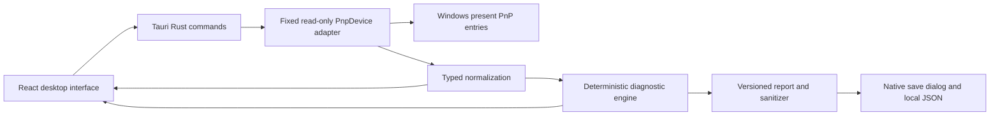

# AnyDevice — Understand. Diagnose. Investigate.

A local-first desktop toolkit for inspecting devices, collecting technical evidence, investigating problems, and progressively reverse-engineering supported interfaces.

The existing Windows candidate provides Plug and Play inventory through a USB/HID-focused discovery adapter, deterministic findings, device inspection, and local JSON report export. Broader inventory, controlled investigations and offline format analysis are development milestones.

It does not establish complete physical health or diagnose batteries, charging circuits, Bluetooth connections, Android file-transfer mode, firmware or arbitrary protocols. No repairs, telemetry, external AI or mandatory accounts are involved.

## Actual delivery status

This is an independently created project, separate from PACT and other folders. The master implementation specification is preserved in [MASTER-SPEC.md](MASTER-SPEC.md).

Source, React interface, fixed Windows discovery adapter, diagnostic engine, tests, docs and Windows NSIS CI are implemented. **The Windows installer and standalone executable were built and verified in CI; the standalone also launched on the development host.** Both are staged in an [owner-visible draft prerelease](https://github.com/Aayush10016/AnyDevice/releases/tag/untagged-8a756fcda793eee58e44). See [VALIDATION.md](docs/VALIDATION.md) for actual results and outstanding release gates. This is an unsigned Windows candidate, not a completed stable v0.1 release.

The new remote is [**Aayush10016/AnyDevice**](https://github.com/Aayush10016/AnyDevice). Its owner was verified. No different account was used. See [GitHub setup](docs/GITHUB.md).

## What works in this implementation

- On-demand present USB and HID discovery through a fixed Windows PowerShell PnpDevice adapter embedded in the Rust binary.
- USB instance IDs are classified as USB; other HID entries retain unknown transport. Composite devices and interface entries stay distinct.
- Instance ID, hardware IDs, friendly name, class, status, problem code, manufacturer, parent and location, when Windows supplies them.
- Search and category/status filters; device inspection, copyable IDs and raw normalized evidence.
- Observed Windows problems, missing metadata, collection/permission errors, and disappearance between complete scans in the same session.
- Findings distinguish observations and Windows-reported errors from unknown root causes, and offer safe next tests.
- Exact JSON preview, local native Save dialog, conservative sanitization, and previous-scan evidence for disappearance findings.
- Light, dark and system appearance with persisted local preferences; keyboard focus, Ctrl+F search and Escape to close inspection.
- A 45-second native timeout, cancellation with child-process termination, partial collection errors and retained stale inventories after failure.

## Installation

Once a verified release exists, download its Windows x64 NSIS installer from the **Aayush10016/AnyDevice** Releases page, compare SHA-256 with `SHA256SUMS.txt`, and install for the current user. Installer CI includes the offline Microsoft WebView2 installer. End users need no Node, Rust, Python or developer tools. The portable `.exe` requires WebView2 already installed; see [PORTABLE.md](docs/PORTABLE.md).

Current unsigned builds have no verified publisher identity and may trigger SmartScreen. Signing requirements and release gates are documented in [BUILD.md](docs/BUILD.md). No signature or antivirus assurance is claimed.

| Platform | Status |
| --- | --- |
| Windows 10/11 x64 + Windows PowerShell 5.1 PnpDevice | Targeted; discovery adapter tested on the current Windows host |
| Windows ARM64 / x86 | Not packaged or verified |
| Linux / macOS | Unsupported; discovery returns an explicit error |
| Locked-down Windows / unavailable CIM or PnpDevice | Structured collection errors; no bypass or auto-elevation |

## Architecture



The domain engine is independent of React and hardware. Rust controls process lifecycle and report saving; PowerShell only obtains Windows observations. No backend server runs in production. The Vite server is development-only. See [ARCHITECTURE.md](docs/ARCHITECTURE.md).

## Development and testing

Windows developers need Node.js 22.12+ or 24 LTS, stable Rust with the MSVC toolchain, Microsoft C++ Build Tools/Windows SDK, and WebView2. Then:

```powershell
npm ci
npm test
npm run build
npm run desktop
cargo test --manifest-path src-tauri/Cargo.toml
npm run package
```

Browser preview (`npm run dev`) cannot scan hardware or save reports. It clearly reports this limitation and loads no fabricated devices. Synthetic fixtures live exclusively in `src/fixtures.ts` and tests. An example sanitized synthetic report is in `docs/examples/`.

Screenshots are only to be added after capturing the implemented interface. Any browser-only capture is labelled as a frontend preview, not a packaged Windows application. Real hardware inventories must not be committed to this public repository.

## Documentation

[Architecture](docs/ARCHITECTURE.md) · [Diagnostic rules](docs/RULES.md) · [Build and release](docs/BUILD.md) · [Validation](docs/VALIDATION.md) · [Privacy](PRIVACY.md) · [Security](SECURITY.md) · [Contributing](CONTRIBUTING.md) · [Changelog](CHANGELOG.md)

## Next three priorities

1. Complete packaged visual/accessibility/resizing QA, real scan/export/disconnect exercises, genuine screenshots and clean-machine Windows 10/11 tests.
2. Replace the allowed PnpDevice fallback with SetupAPI/Configuration Manager discovery, compare coverage and permission behavior, and expand lifecycle tests.
3. Conduct keyboard/screen-reader and resizing QA on the packaged app, add genuine desktop screenshots, and configure verified code signing before a public v0.1 release.

MIT licensed. See [LICENSE](LICENSE) and [THIRD_PARTY.md](THIRD_PARTY.md).
