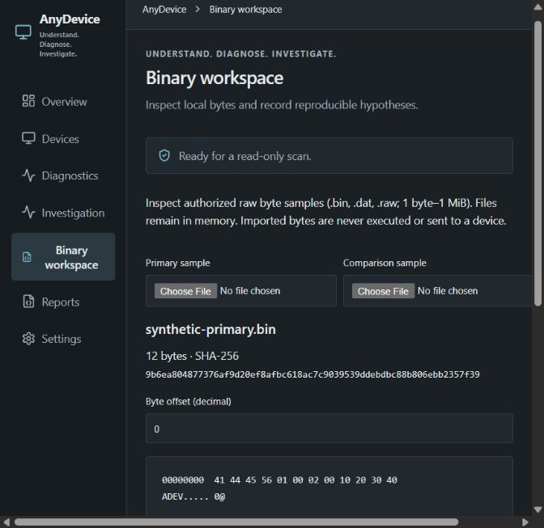

# AnyDevice — Understand. Diagnose. Investigate.

A local-first desktop toolkit for inspecting devices, collecting technical evidence, investigating problems, and progressively reverse-engineering supported interfaces.

## Current implementation

The 0.2.0 development candidate builds on the working 0.1.0 Windows application. It adds native Windows Configuration Manager inventory, optional all-present-PnP collection, controlled snapshot investigations, and bounded offline binary sample inspection. Capability labels and test results are in [CAPABILITIES](docs/CAPABILITIES.md) and [EXPANSION-VALIDATION](docs/EXPANSION-VALIDATION.md).

- Native present-node discovery: instance/hardware IDs, class, name or description, manufacturer, parent, location, Windows status/problem code when exposed. Normal user operation; no auto-elevation.
- USB/HID scope by default; all-present-PnP scope can include Bluetooth, audio, camera, network, storage, volume and printer **nodes** when Windows exposes those classes. Unknown transport stays unknown. Physical grouping and interface paths are not collected.
- Fixed read-only PowerShell PnpDevice adapter retained for USB/HID parity and fallback selection.
- Search, class/status filtering, inspection and raw evidence; deterministic Windows problem-code, missing-property, collection-error and disappearance findings. Complete scans from the same provider/scope are required for absence comparisons.
- Investigation baselines, up to eight captures, additions/removals/property changes, separate user annotations, timeline and sanitized local JSON export.
- Offline .bin/.dat/.raw samples up to 1 MiB: paged hex/ASCII, offset annotations, aligned two-sample byte comparison, SHA-256 and exportable analysis metadata. Hypotheses remain unvalidated; imported bytes are never executed.
- Light/dark/system appearance, local preferences, exact export previews, explicit native save dialogs and schema-validated exports.

An OK operating-system status does not establish complete physical health. There is no Bluetooth radio/connection inspection, audio stream analysis, SMART/volume health diagnosis, ADB/MTP connection diagnosis, USB traffic capture, format parser generation, device repair, firmware flashing or driver modification. No cloud backend, telemetry, external AI or mandatory accounts.

## Windows downloads and release status

Repository: [Aayush10016/AnyDevice](https://github.com/Aayush10016/AnyDevice). Windows 10/11 x64 is the supported target; macOS, Linux, ARM64 and x86 are unsupported/unverified.

The existing unsigned [0.1.0 draft candidate](https://github.com/Aayush10016/AnyDevice/releases/tag/untagged-8a756fcda793eee58e44) and its source commit 28eed5435a1dca47963775caa38578f5e054f709 remain unchanged. New development builds are separate GitHub Actions artifacts; consult the expansion validation record for the exact verified build. No stable release is automatically published.

The NSIS installer includes the offline Microsoft WebView2 installer. The standalone executable requires installed WebView2. End users need no Node, Rust, Python or developer tools. Compare downloads with the provided SHA256SUMS.txt. Unsigned candidates may trigger SmartScreen and do not carry a verified publisher identity. See [build and release gates](docs/BUILD.md).

## Local use

Scan on Overview/Devices. Settings selects provider and inventory scope; changes require another scan and mark the old snapshot stale. Device details show actual source/time; missing properties are unavailable.

For a controlled investigation, scan a complete baseline, open Investigation and record it, perform your own safe action, refresh, annotate your action, then capture the new snapshot. Partial or different-scope captures retain evidence but abstain from comparison. Export before closing; evidence is volatile.

Binary workspace accepts raw byte samples only. Annotate a range using decimal offset and length. A common prefix is an observation, not a confirmed format header. Metadata exports exclude sample bytes; share source fixtures separately only when authorized.

Reports and all workspace exports obey the sanitization preference in Settings. Sanitized exports remove free-text hardware metadata, identities and user annotations; analysis filenames/hashes/hypothesis labels are withheld. Timestamps, classes, VID/PID and offsets/lengths can still be sensitive. Review the exact preview.

## Build and tests

Windows developers need Node 22.12+ or 24 LTS, Rust/MSVC C++ Build Tools and Windows SDK, and WebView2. Windows PowerShell/PnpDevice is needed only for the optional fallback/parity test.

```powershell
npm ci
npm run check:branding
npm test
npm run build
cargo test --manifest-path src-tauri/Cargo.toml --locked --features custom-protocol
npm run desktop
npm run package
```

The browser preview cannot collect hardware or save through native dialogs and loads no synthetic devices. Test fixtures and examples are explicitly synthetic. Real inventories must never be committed or uploaded to public CI logs.

## Implemented interface preview



Browser frontend capture, not a packaged Windows screenshot or a hardware inventory. Native screen-reader/dialog QA remains a release gate.

## Documentation

[Architecture](docs/ARCHITECTURE.md) · [Capabilities](docs/CAPABILITIES.md) · [Implementation plan](docs/IMPLEMENTATION-PLAN.md) · [Rules](docs/RULES.md) · [Validation](docs/EXPANSION-VALIDATION.md) · [Privacy](PRIVACY.md) · [Security](SECURITY.md) · [Branding](docs/BRANDING.md) · [Contributing](CONTRIBUTING.md)

The original [MASTER-SPEC.md](MASTER-SPEC.md) is preserved as historical input. The current product identity and staged expansion supersede its old tagline and narrow release subtitle.

## Next engineering priorities

1. Packaged UI/export/keyboard/accessibility QA, safe physical unplug/replug and clean Windows 10/11 upgrade checks; capture genuine shareable screenshots.
2. Extend native device-interface/topology observations, then introduce dedicated Bluetooth/audio/storage providers only with real evidence and independent tests.
3. Add reproducible binary project import/fixtures and independently validated parsers before considering any explicitly approved software recovery operation.

MIT licensed; see [LICENSE](LICENSE) and [THIRD_PARTY.md](THIRD_PARTY.md).
