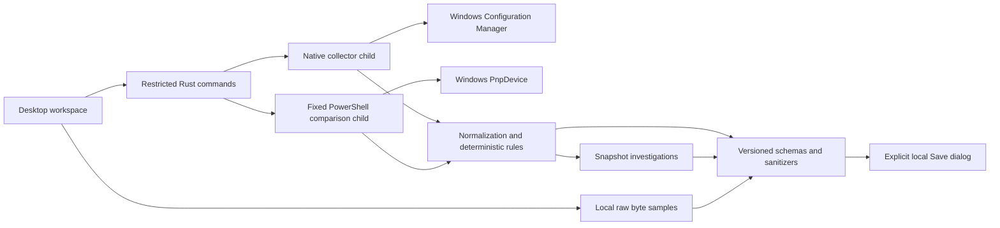

# Architecture

Tauri 2 embeds React/TypeScript/Vite. Rust exposes only scan, cancel, validated evidence save and fixed project links. No backend, database or cloud dependency.

| Layer | Files | Behavior |
| --- | --- | --- |
| Provider definitions | src/providers.ts, src/models.ts | Version, scopes, dependencies, permissions, observations, limitations |
| Native discovery | src-tauri/src/native.rs | Maintained windows-sys Configuration Manager bindings; present logical PnP nodes and typed properties |
| Fallback | src-tauri/scripts/discover.ps1 | Unchanged compile-time-embedded read-only USB/HID PnpDevice adapter |
| Native boundary | src-tauri/src/main.rs | Fixed collector subprocesses, timeout/kill/cancel, streaming output limit, native save dialog |
| Normalization and rules | src/core.ts | Stable identity, explicit unknowns, allowed provenance, deterministic findings and same-source/scope abstention |
| Investigation | src/investigation.ts | Bounded volatile snapshots, field comparison, user annotations and session-wide sanitized aliases |
| Offline bytes | src/binary.ts | Size/extension validation, SHA-256, 256-byte hex pages, offset fields and bounded comparison output |
| Export validation | src/reporting.ts, docs/*.schema.json | Ajv schema validation before IPC; native envelope and byte-limit validation before a user-selected write |
| UI | src/App.tsx, src/WorkspacePanels.tsx | Working navigation and previews; no planned feature routes |

Native enumeration uses CM_Get_Device_ID_List_SizeW/ListW with PRESENT, CM_Locate_DevNodeW, CM_Get_DevNode_PropertyW, CM_Get_DevNode_Status and CM_Get_Parent/Get_Device_IDW. Property type/length is checked, optional absent values remain unknown, numeric CONFIGRET establishes permission errors. Friendly name falls back to the OS device description. Normal-user reads do not modify registry/device configuration. Parent/location are observations, not inferred physical grouping.

Microsoft references: [present instance list](https://learn.microsoft.com/en-us/windows/win32/api/cfgmgr32/nf-cfgmgr32-cm_get_device_id_listw), [unified properties](https://learn.microsoft.com/en-us/windows/win32/api/cfgmgr32/nf-cfgmgr32-cm_get_devnode_propertyw), [node status](https://learn.microsoft.com/en-us/windows/win32/api/cfgmgr32/nf-cfgmgr32-cm_get_devnode_status).

Native enumeration retries a resized inventory list three times, bounds properties to 64 KiB, examines at most 16,384 nodes, emits at most 4096 nodes, bounds device evidence to 12 MiB, stops cooperatively at 40 seconds and is forcibly terminated by the parent at 45 seconds. IPC stdout is read with a 16 MiB+1 bounded stream; overflow/cancel/timeout drops the kill-on-drop child. Partial results carry collection errors. Errors and unknown properties are not physical faults.

The fallback script remains unchanged for parity. A failed scan retains the prior inventory and marks it stale. A snapshot ages after 60 seconds. Comparisons require complete scans with identical provider and scope. Windows hot-plug collection is not atomic: repeated scans/parity may disagree during actual changes. No logical node is silently combined with a physical device or claimed to expose a device-interface path.

Investigations store at most 8 captures and 8 MiB serialized evidence, solely in memory. Binary imports hold at most two 1 MiB samples and 256 hypotheses; comparison reports the first 256 differing offsets while counting all differences. No parser is generated or executed. Version 2.0 diagnostic, investigation-1.0 and binary-analysis-1.0 exports are schema checked. Original report-v1.schema.json preserves the previous schema definition; there is no imported-report reader/migration claim.

React renders untrusted strings as text. CSP remains local. Custom commands expose no arbitrary executable, command text, URL or destination path. Save writes only validated content through a native user-selected dialog. No shell, network or general filesystem plugin is exposed.
